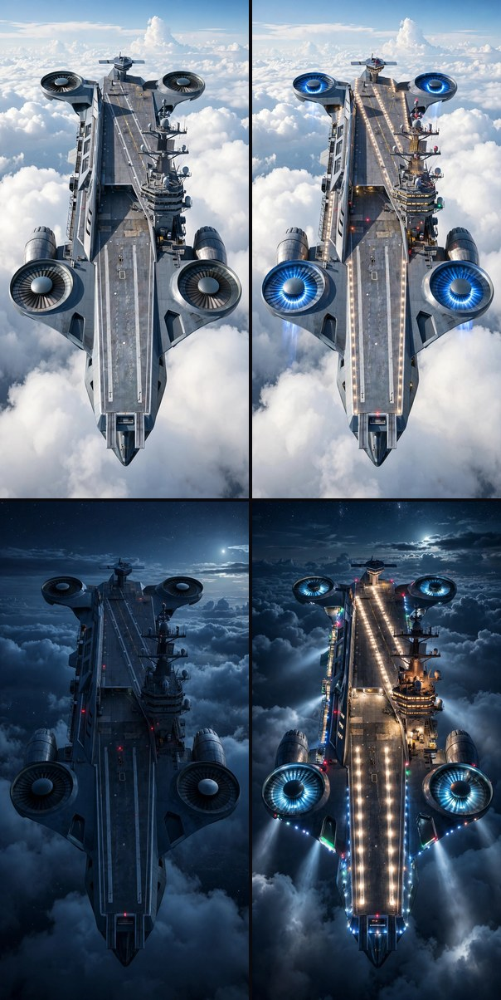
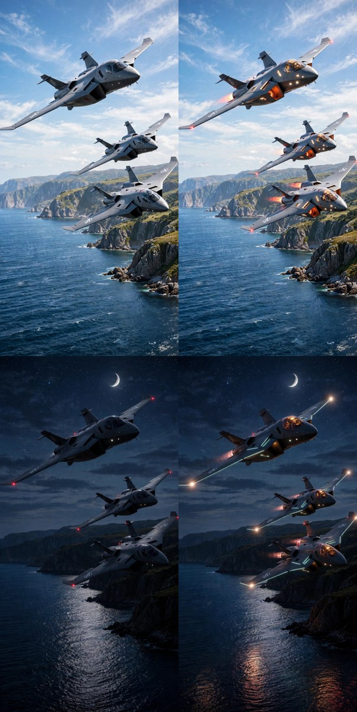
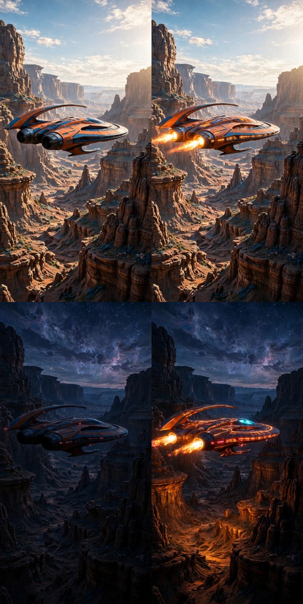
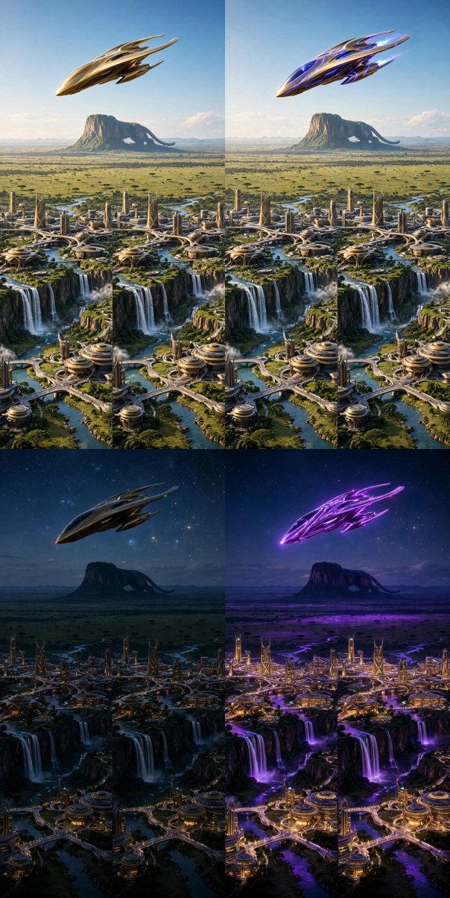
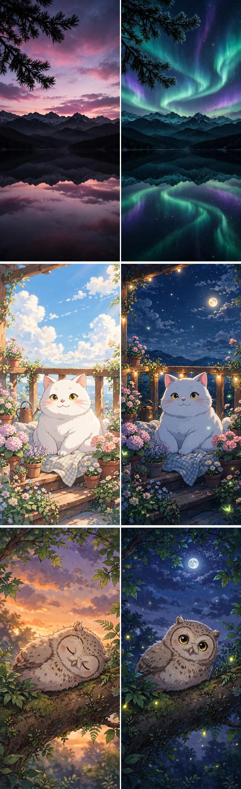
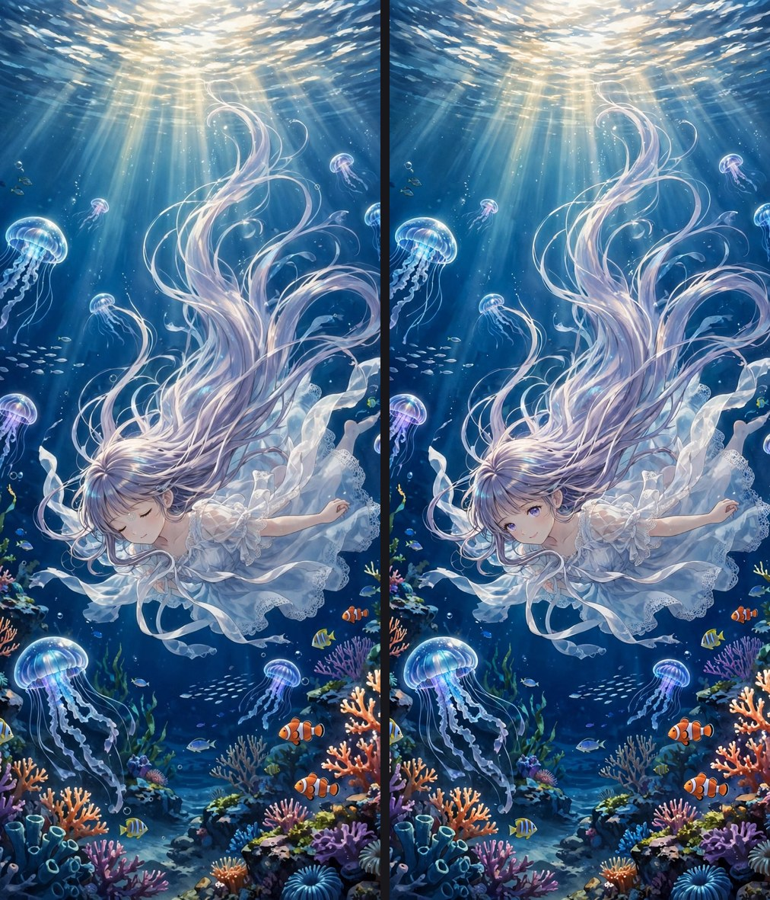

# 🔓 Unlock Tendies · iOS 解锁变身壁纸合集

> **锁屏一景，解锁变身。**
> 每个壁纸包都有两张严格同构图的画面：锁屏时是第一张，**在滑动解锁的过程中**，第二张会以弹簧动画缓缓浮现——不是解锁完才切换，而是跟着你的手势一起变。

---

## ✨ 这是什么

基于 iOS PosterBoard 的 `.tendies` 动态壁纸包，借用系统原生的锁定 / 解锁状态机（Locked / Unlock / Sleep）驱动画面切换：

- 🔒 **锁屏** → 显示第一状态（如冬日的枯木、黄昏、酣睡）
- 🔓 **解锁过程中** → 第二状态以 0.8 秒弹簧动画淡入（如新绿满树、月夜、醒来）
- 📱 **主屏幕** → 停留在解锁后的画面
- ↩️ **重新锁屏** → 画面回到第一状态

全部 7 张均已在真机实测可用（iPhone 16e · iOS 27.2 beta）。

---

## 🌊 动态融合系列（新）

在静态变身的基础上更进一步：**锁屏本身是动态的**（VideoCAML 帧动画），同时保留解锁变身——滑动解锁时，第二状态图层照样以弹簧动画淡入。两种机制第一次合进同一个壁纸包。

| 壁纸 | 文件 | 🔒 锁屏 | 🔓 解锁后 | 安装 |
| --- | --- | --- | --- | --- |
| 🪼 深海水母·醒 | `Jellyfish-Awake-Video.tendies` | 闭眼漂浮的少女，气泡缓缓上浮（12 秒循环动态） | 睁开眼睛，略带微笑 | **Gester** |

> 📥 这个包约 45 MB，超过了仓库单文件上限，放在 [**Releases**](https://github.com/xxzhil/unlock-tendies/releases/tag/jellyfish-awake-v1) 里：[点此下载 Jellyfish-Awake-Video.tendies](https://github.com/xxzhil/unlock-tendies/releases/download/jellyfish-awake-v1/Jellyfish-Awake-Video.tendies)
>
> ⚠️ 融合系列请用 **Gester** 安装（和上面 7 张相反）——它走的是 VideoCAML 描述符路线。下载后分享到 Gester 导入应用，再到壁纸图库里选用即可，不需要再单独配主屏图片，一个包搞定。
>
> 真机实测可用（iPhone 16e · iOS 27.2 beta，2026-11-13）。

---

## 🚀 四态系列（昼夜 × 解锁 · 新）

在解锁变身的基础上再叠一层系统外观：每个包有 **4 张严格同构图的画面**——浅色模式一套（锁屏 / 解锁）、深色模式一套（锁屏 / 解锁）。系统切到深色模式，整套画面换成夜景版；滑动解锁时，飞行器会在手势过程中「点火」亮起。

| 壁纸 | 文件 | ☀️ 浅色：锁屏 → 解锁 | 🌙 深色：锁屏 → 解锁 |
| --- | --- | --- | --- |
| 🚢 空天母舰 | `Helicarrier-Quad.tendies` | 云海之上俯瞰母舰甲板，涡轮熄火 → 涡轮蓝光点亮、甲板跑道灯带全开 | 夜幕下的母舰，仅红色微光 → 全舰灯光与探照灯点亮 |
| 🛩️ 昆式编队 | `Quinjet-Quad.tendies` | 崖岸海面上空编队巡航，灯光关闭 → 座舱、导航灯与引擎点亮 | 月夜编队，仅微光导航灯 → 全机灯光点亮，海面映光 |
| 🚀 米兰诺号 | `Milano-Quad.tendies` | 外星红岩峡谷飞行，引擎熄火 → 尾焰点火 | 星云夜空，仅剩微光 → 引擎全开，峡谷被映亮 |
| 👑 瓦坎达飞行器 | `Wakanda-Quad.tendies` | 王城上空巡航，哑光金机身 → 蓝紫能量纹点亮 | 夜幕王城，灯火稀疏 → 飞行器紫光全开，全城亮起 |

四态预览（每张四格：左上 浅色锁屏 · 右上 浅色解锁 · 左下 深色锁屏 · 右下 深色解锁）：

**空天母舰**

**昆式编队**

**米兰诺号**

**瓦坎达飞行器**

> 安装方式与解锁系列相同（GestaltX，见下方）。底层是六状态状态机：Locked / Unlock / Sleep × Light / Dark。

---

## 📦 壁纸列表

| 壁纸 | 文件 | 🔒 锁屏 | 🔓 解锁后 |
| --- | --- | --- | --- |
| 🌳 枯木逢春 | `WitheredLush-Unlock.tendies` | 冬日枯木 | 满树新绿 |
| 🏝️ 海岛日夜 | `Unlock-SeaHD.tendies` | 落日金海 | 满月银海 |
| 🌸 樱花月夜 | `Unlock-Sakura.tendies` | 白天樱花山谷 | 月夜樱花 |
| 🌲 森林晨光 | `Unlock-Forest.tendies` | 雾气晨光 | 月光森林 |
| 🏔️ 雪山极光 | `Unlock-SnowAurora.tendies` | 黄昏雪山湖 | 极光之夜 |
| 🐱 白猫日夜 | `Unlock-Cat.tendies` | 阳光花阳台上的胖白猫 | 月夜串灯与萤火虫 |
| 🦉 林间猫头鹰 | `Unlock-Owl.tendies` | 黄昏酣睡 | 月夜睁开大眼睛 |

---

## 👀 预览（左：锁屏 · 右：解锁后）

**海岛日夜 / 樱花月夜 / 森林晨光**

**雪山极光 / 白猫 / 猫头鹰**

**深海水母·醒（动态融合：左锁屏闭眼 · 右解锁后睁眼微笑）**

---

## 📲 安装方法

1. 在 [`wallpapers/`](wallpapers/) 里下载想要的 `.tendies` 文件到 iPhone
2. 通过分享菜单把文件发送到 **GestaltX**，在 GestaltX 里导入并「应用」
3. 回到桌面：**长按锁屏 → 点 + 新增**，在壁纸图库里选中它
4. 锁屏后划动解锁，即可看到画面在解锁过程中变身 ✨

> ⚠️ 这类壁纸包请用 **GestaltX** 安装，不要用 Gester——Gester 写入同类描述符时会损坏渲染（实测会出现占位图 / 闪退）。

---

## 🛠️ 技术说明

- `.tendies` 本质是一个 ZIP 包，内含 PosterBoard 描述符（7400 家族）
- 底层 Background 图层放第一状态静态图 + 完整的 Locked / Unlock / Sleep 状态脚手架
- 上层 Floating 图层放第二状态全屏图，按状态设透明度（Locked 0 / Unlock 1 / Sleep 0）
- 状态切换使用 `CASpringAnimation`（damping 50 · mass 2 · stiffness 300 · 0.8s），由 PosterBoard 在解锁手势期间驱动
- 画面为 AI 生成的一对同构图素材，分辨率 1206 × 2622
- **动态融合系列**的配方不同：Background 是 VideoCAML 帧动画（144 帧 JPG，12 秒无缝循环），Floating 图层改放第二状态全屏图并写入同样的状态机（透明度 Locked 0 / Unlock 1 / Sleep 0 + 弹簧过渡），因此锁屏保留动态、解锁依然变身
- **四态系列**把状态机扩展为六个状态（Locked / Unlock / Sleep 各分 Light / Dark）：Background 图层放浅色与深色两张基础图、Floating 图层放浅色与深色两张解锁图，各自按状态交叉控制透明度，因此系统外观切换与解锁手势两个维度互不干扰

---

## ⚠️ 免责声明

- 本仓库壁纸为 AI 生成素材，仅供个人学习与交流，请勿商用
- 使用 PosterBoard 注入类工具存在一定风险，请提前备份，风险自负
- 适用环境为实测通过的 iOS 27.2 beta，其他版本请自行测试
