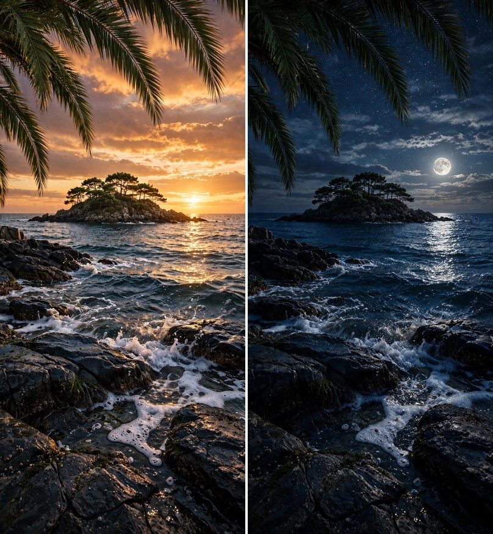
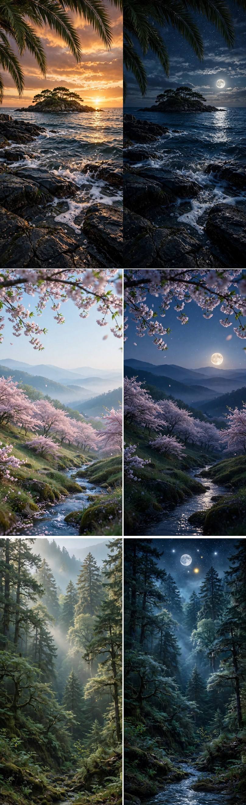

# 🔓 Unlock Tendies · iOS 解锁变身壁纸合集

> **锁屏一景，解锁变身。**
> 每个壁纸包都有两张严格同构图的画面：锁屏时是第一张，**在滑动解锁的过程中**，第二张会以弹簧动画缓缓浮现——不是解锁完才切换，而是跟着你的手势一起变。

---

## ✨ 这是什么

基于 iOS PosterBoard 的 `.tendies` 动态壁纸包，借用系统原生的锁定 / 解锁状态机（Locked / Unlock / Sleep）驱动画面切换：

- 🔒 **锁屏** → 显示第一状态（如冬日的枯木、黄昏、酣睡）
- 🔓 **解锁过程中** → 第二状态以 0.8 秒弹簧动画淡入（如新绿满树、月夜、醒来）
- 📱 **主屏幕** → 停留在解锁后的画面
- ↩️ **重新锁屏** → 画面回到第一状态

全部 7 张均已在真机实测可用（iPhone 16e · iOS 27.2 beta）。

---

## 📦 壁纸列表

| 壁纸 | 文件 | 🔒 锁屏 | 🔓 解锁后 |
| --- | --- | --- | --- |
| 🌳 枯木逢春 | `WitheredLush-Unlock.tendies` | 冬日枯木 | 满树新绿 |
| 🏝️ 海岛日夜 | `Unlock-SeaHD.tendies` | 落日金海 | 满月银海 |
| 🌸 樱花月夜 | `Unlock-Sakura.tendies` | 白天樱花山谷 | 月夜樱花 |
| 🌲 森林晨光 | `Unlock-Forest.tendies` | 雾气晨光 | 月光森林 |
| 🏔️ 雪山极光 | `Unlock-SnowAurora.tendies` | 黄昏雪山湖 | 极光之夜 |
| 🐱 白猫日夜 | `Unlock-Cat.tendies` | 阳光花阳台上的胖白猫 | 月夜串灯与萤火虫 |
| 🦉 林间猫头鹰 | `Unlock-Owl.tendies` | 黄昏酣睡 | 月夜睁开大眼睛 |

---

## 👀 预览（左：锁屏 · 右：解锁后）

**海岛日夜 · 高清版**

**海岛（旧版素材）/ 樱花 / 森林**

**雪山极光 / 白猫 / 猫头鹰**

---

## 📲 安装方法

1. 在 [`wallpapers/`](wallpapers/) 里下载想要的 `.tendies` 文件到 iPhone
2. 通过分享菜单把文件发送到 **GestaltX**，在 GestaltX 里导入并「应用」
3. 回到桌面：**长按锁屏 → 点 + 新增**，在壁纸图库里选中它
4. 锁屏后划动解锁，即可看到画面在解锁过程中变身 ✨

> ⚠️ 这类壁纸包请用 **GestaltX** 安装，不要用 Gester——Gester 写入同类描述符时会损坏渲染（实测会出现占位图 / 闪退）。

---

## 🛠️ 技术说明

- `.tendies` 本质是一个 ZIP 包，内含 PosterBoard 描述符（7400 家族）
- 底层 Background 图层放第一状态静态图 + 完整的 Locked / Unlock / Sleep 状态脚手架
- 上层 Floating 图层放第二状态全屏图，按状态设透明度（Locked 0 / Unlock 1 / Sleep 0）
- 状态切换使用 `CASpringAnimation`（damping 50 · mass 2 · stiffness 300 · 0.8s），由 PosterBoard 在解锁手势期间驱动
- 画面为 AI 生成的一对同构图素材，分辨率 1206 × 2622

---

## ⚠️ 免责声明

- 本仓库壁纸为 AI 生成素材，仅供个人学习与交流，请勿商用
- 使用 PosterBoard 注入类工具存在一定风险，请提前备份，风险自负
- 适用环境为实测通过的 iOS 27.2 beta，其他版本请自行测试
